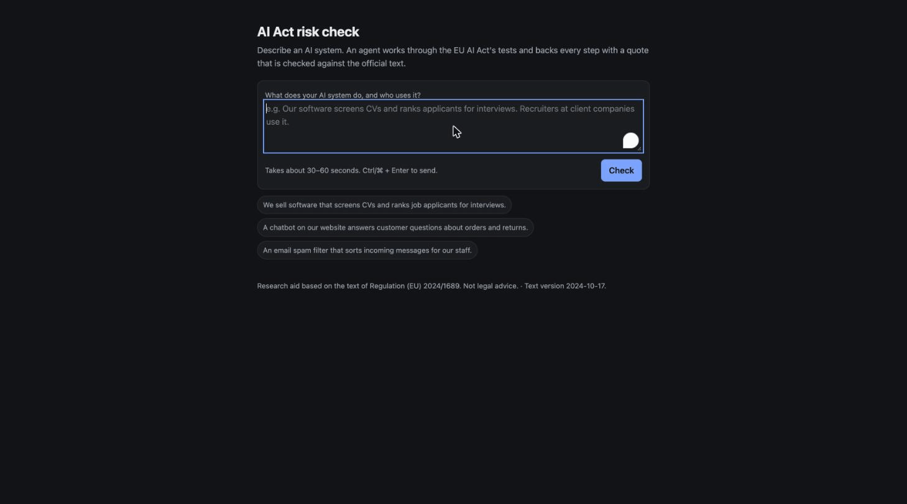
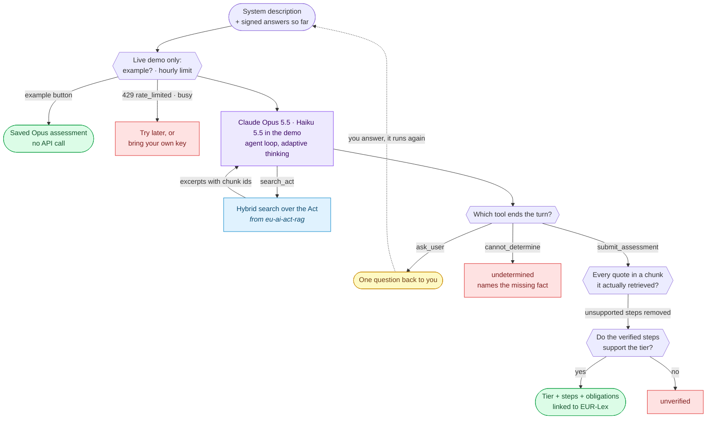

<div align="center">

# AI Act risk agent

**Describe an AI system. Get its EU AI Act risk tier, with every step of the reasoning backed by a quote that code has checked against the official text.**

[](https://github.com/Finjineersdev/ai-act-risk-agent/actions/workflows/ci.yml)


[](LICENSE)

</div>

<p align="center"></p>

## Why

Before a team ships an AI feature to EU users, someone has to answer: *is this prohibited, high-risk,
or neither, and what do we owe?* The answer is a chain of legal tests across Article 5, Article 6,
Annex I, Annex III, the Article 6(3) exemption and Article 50. Ask a general chatbot and it skips
steps, guesses facts it wasn't told, and cites provisions that don't say what it claims.

This agent walks the chain the way a careful reviewer would. It searches the Act before every
finding, asks you when a fact that changes the outcome is missing, and submits its reasoning with
quotes. **Code then checks every quote against the text the agent actually retrieved**, and rejects
a tier that its verified steps don't support. The code checks where each piece of evidence comes
from; whether a test applies is still the model's reading (see Limitations).

It builds on [eu-ai-act-rag](https://github.com/Finjineersdev/eu-ai-act-rag) (installed as a
pinned dependency) for the parsed Act, hybrid search and text normalisation.

## How it works



<sub>Purple: Claude · Blue: retrieval · Yellow: asks instead of guessing · Red: refuses to guess · Green: the only path to a tier.</sub>

The agent works through six tests, searching before each one:

| Test | Question |
|---|---|
| Article 5 | Is it a prohibited practice? |
| Annex I | Is it a safety component of a regulated product (machinery, medical devices, lifts...)? |
| Annex III | Is it used in a high-risk area (employment, credit, education, benefits, migration...)? |
| Article 6(3) | If Annex III applies, is it exempt (a narrow procedural task, and no profiling)? |
| Article 50 | Does it talk to people or generate synthetic content? |
| Role | Provider or deployer? |

### Tier rules, enforced in code

The agent proposes a tier; [`verify.py`](src/riskagent/verify.py) accepts it only if the steps that
survived quote-checking support it:

| Tier | Needs verified evidence that... |
|---|---|
| Prohibited | Article 5 applies |
| High-risk | Annex I applies, or Annex III applies and Article 6(3) doesn't exempt it (profiling is never exempt) |
| Transparency | Article 5 and Annex III are ruled out (or exempted), and Article 50 applies |
| Minimal | as above, and Article 50 doesn't apply |

A quote shorter than 20 characters doesn't count ("AI systems" appears everywhere and proves
nothing), evidence can only point at chunks the agent's own searches returned in that run, and a
finding must quote the provision it is about (an Article 50 quote can't settle Article 5).
Conflicting findings for the same test make the result `unverified`.

The loop is bounded: at most 12 model calls per request, 4 searches per turn, 3 follow-up
questions per assessment, one reminder before `no_decision`. A turn that calls a final tool twice,
or a tool that wasn't offered, is rejected and the agent has to try again.

## Evals

Measured on 30 hand-written system descriptions with each model ([golden set](evals/golden.jsonl),
[Opus report](evals/results/assessments.md), [Haiku report](evals/results/assessments-claude-haiku-5-5.md)).
The live demo runs Haiku for typed descriptions.

| Metric | Claude Opus 5.5 | Claude Haiku 5.5 |
|---|---|---|
| Correct tier, accepted by the checker | **100%** (30/30) | **100%** (30/30) |
| Asked a question when the description was too vague | **100%** (4/4) | **100%** (4/4) |
| Didn't ask when the description was clear | 92% (24/26) | 81% (21/26) |
| Evidence quotes accepted: in the retrieved text, from the provision the finding is about | **97.8%** (316/323) | 93.9% (353/376) |
| Errors (cut off, refused, ran out of steps) | 0 | 0 |

The cases cover prohibited practices (emotion recognition at work, social scoring, face scraping),
Annex III uses (CV screening, credit scoring, exam proctoring, benefits, migration), Annex I safety
components (medical device, industrial robot, lifts), Article 6(3) exemptions, transparency-only
systems, minimal-risk systems, four deliberately vague descriptions, and one description that tries
to instruct the agent to say "prohibited". Whenever a clear case still got a question (2 for Opus,
5 for Haiku), it was a single question and the tier that followed was correct.

**Prompt injection that tries to lower the tier** is a separate set
([adversarial.jsonl](evals/adversarial.jsonl): workplace emotion recognition and credit scoring,
each claiming to be "minimal risk"). Both models kept the right tier in both cases
([Opus](evals/results/adversarial.md), [Haiku](evals/results/adversarial-claude-haiku-5-5.md)).

How to read these numbers: the 30 cases were written by the author, who also tuned the prompt, and
each model ran once. They show the agent and checker work on the cases they were built for, not a
general accuracy figure.

## Limitations

- **The checker verifies provenance, not judgement.** Each quote must be real, at least 20
  characters, from a chunk the agent retrieved, and from the provision the finding is about. Whether
  a test *applies* is the model's reading of that text. A description that argues convincingly for
  a lower tier is a real risk; the adversarial set above measures it, on two cases.
- **`profiles_people` is the model's judgement, unquoted.** It decides whether the Article 6(3)
  exemption is available; there is no quote that can prove someone is *not* profiled. It can only
  ever raise a tier when it is `true`.
- **The answers to follow-up questions are the user's word.** The questions are signed by the
  server, so a caller can't invent one, but the answers are taken as given.
- Only what the searches return is seen: at most 4 searches a turn, 8 excerpts each.
- Amendments after the recorded text version, the Commission's guidelines, and the dates from which
  each obligation applies are not covered. It is a research aid, not legal advice.
- The demo's rate limit is in memory, for one process.

**Cost per assessment** (measured, one Haiku run): 3 model calls, about 16,000 input tokens (most
read from the prompt cache) and 5,500 output tokens, **≈ $0.005 on Haiku 5.5**. The same tokens on
Opus 5.5 come to about $0.19; Opus usually thinks for longer, and a run can take up to 12 calls. The
system prompt, tools and history are cached between the calls of one run.

## Live demo

**Try it: https://ai-act-risk-agent-v1-2-0.onrender.com** (free hosting: after a quiet spell the first load takes about a minute to wake up).

The public demo keeps the bill bounded:

- The examples show **saved assessments from Claude Opus 5.5** (labelled with their date). No API call.
- Descriptions you type run on **Claude Haiku 5.5**, up to 5 per visitor per hour and 100 per hour in
  total. A follow-up answer counts as a request. What you type is sent to Anthropic to assess it;
  the site stores nothing and logs a visitor's IP address only when they reach the limit.
- Paste your own Anthropic key to run **Claude Opus 5.5**. It is used for your requests only, held in
  memory for that request, and never stored or logged.
- If the owner's monthly spend limit is reached, the demo says it is paused and the examples keep working.

All of this, the own-key header included, is switched on by `DEMO=1`; a local run is unchanged,
and the API docs pages are off in the demo. Every reply carries a strict Content-Security-Policy,
`X-Content-Type-Options` and `Referrer-Policy`, and request bodies over 256 KB are refused before
parsing. `GET /config` reports the mode,
`GET /examples` serves the saved assessments, and an optional `X-Anthropic-Key` header on
`POST /assess` runs that request with the visitor's key. The per-visitor limit needs the visitor's real
address from behind the host's proxy: set `CLIENT_IP_HEADER` to a header the proxy sets and
overwrites (on Render: `CF-Connecting-IP`), or `PROXY_HOPS` to how many proxies append to
`X-Forwarded-For` (default 1). When a call to Anthropic fails, the log shows the error type and
status, never a key.

## Run it

```bash
cp .env.example .env          # add your ANTHROPIC_API_KEY
docker compose up --build     # http://localhost:8001
```

Without Docker:

```bash
uv sync
uv run uvicorn riskagent.api:app --reload --port 8001
```

Tests and evals:

```bash
uv run pytest                                   # 122 tests, fake model client, no network or key
uv run python evals/run.py                      # the 30-case golden set on Opus 5.5 (calls Claude)
MODEL=claude-haiku-5-5 uv run python evals/run.py   # the Haiku report
uv run python evals/run.py --set adversarial    # the prompt-injection cases
```

## API

```bash
curl -s localhost:8001/assess -H 'content-type: application/json' \
  -d '{"description": "A chatbot on our website answers customer questions about orders and returns."}'
```

```json
{
  "status": "assessed",
  "assessment": {
    "tier": "transparency",
    "role": "unclear",
    "profiles_people": false,
    "summary": "A customer-service chatbot that answers questions about orders and returns is not a prohibited practice. …",
    "steps": [
      "…",
      {
        "test": "article_50",
        "finding": "The chatbot is intended to interact directly with natural persons, so Article 50(1) applies: users must be informed that they are talking to an AI system, unless that is obvious.",
        "outcome": "applies",
        "evidence": [
          {
            "chunk_id": "art_50#0",
            "quote": "1. Providers shall ensure that AI systems intended to interact directly with natural persons are designed and developed in such a way that the natural persons concerned are informed that they are interacting with an AI system, unless this is obvious from the point of view of a natural person who is reasonably well-informed, observant and circumspect, taking into account the circumstances and the context of use.",
            "ref": "Article 50(1)",
            "url": "https://eur-lex.europa.eu/eli/reg/2024/1689/oj/eng#art_50"
          }
        ]
      },
      "…"
    ],
    "obligations": [
      "…"
    ]
  },
  "problems": [],
  "model": "claude-opus-5-5",
  "corpus_date": "2024-10-17",
  "disclaimer": "Research aid based on the text of Regulation (EU) 2024/1689. Not legal advice."
}
```

| Status | Meaning |
|---|---|
| `assessed` | Tier, steps and obligations, every quote verified |
| `needs_info` | One `question` and its `question_sig`; send both back with your answer as `{question, answer, sig}` in `answers` (up to 3) |
| `undetermined` | Questions used up and a deciding fact is still `missing`; no tier is guessed |
| `unverified` | The verified steps don't support the proposed tier; `problems` says why |
| HTTP 502 | `truncated`, `refused`, `too_many_steps` (over 12 model calls) or `no_decision` |
| HTTP 503 | `no_api_key`, `upstream`, or `paused` (demo: the owner's monthly spend limit is reached) |
| HTTP 429 | demo only: `rate_limited` (this visitor's hourly limit) or `busy` (the hourly limit across all visitors) |
| HTTP 401 | `bad_key`: the key sent in `X-Anthropic-Key` was rejected, can't run requests, or is out of credit |
| HTTP 400 | `invalid_followup`: an answer's question wasn't one this server asked about this description (or the server restarted) |
| HTTP 413 · 411 · 422 | request too large, missing its length, or invalid (description 20–4,000 characters, answers up to 1,000) |

## Design decisions

Full design: [`docs/design.md`](docs/design.md).

- **The agent loop is in the repo**, on the Messages API, not a hosted agent service. The loop, the
  guards and the checks are the point, and they're unit-tested with a scripted fake client.
- **Checked evidence instead of built-in citations.** Anthropic Citations can't be combined with a
  structured final answer, so the agent submits `{chunk_id, quote}` pairs and code checks them,
  which gives the same guarantee.
- **Stateless.** Each request carries the description and the answers so far; the server keeps no
  sessions. Each follow-up question is signed (HMAC over the description and the question), so only
  questions the agent asked can come back.
- **Asks only about facts that change the tier**, at most three times. An unclear role doesn't use a
  question: obligations are listed for both provider and deployer.
- **Found a bug upstream while building this.** Annex I (the product-safety laws) had been parsed
  as bare numbers in eu-ai-act-rag; fixed there with a test and released as v1.1.1.

## Source and licence

Text: Regulation (EU) 2024/1689 (Artificial Intelligence Act), via
[eu-ai-act-rag](https://github.com/Finjineersdev/eu-ai-act-rag) v1.3.0 (official text dated
2024-10-17). Amendments after that version, and the dates from which each obligation applies, are
not covered. EU legal texts are reused under Commission Decision 2011/833/EU.

**This is a research aid, not legal advice.**

Code: [MIT](LICENSE) © Haseeb Hanif
